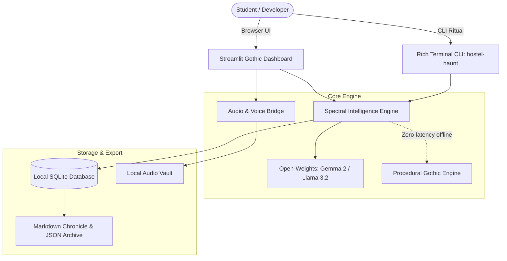

# 🕯️ Hostel Haunt (Ghost in the Machine)

> **"The ghost that lives in your laptop and remembers what the night, the exams, the family calls, and the empty corridors try to forget."**

[](https://dev.to/challenges/hacktoberfest-week4-2026-10-26)
[](https://python.org)
[](https://streamlit.io)
[](https://ollama.ai)
[](LICENSE)

---

## 👻 Overview

Every engineering student carries an invisible ecosystem of ghosts:
1. The **nocturnal shadows** of deserted hostel corridors at 3:15 AM.
2. The **academic dread** of pending backlogs, unread slides, and looming End-Sems.
3. The **fleeting camaraderie** of 2 AM Tapri chai and hostel room banter that will dissolve once graduation arrives.
4. The **distant voices from home**—moms and grandmothers reminding you to eat on time, preserved on WhatsApp voice notes.

Built specifically for the **DEV Hacktoberfest 2026 Week 4 Challenge ("Ghost in the Machine")**, **Hostel Haunt** seamlessly unites eerie **Halloween folklore** with the sacred remembrance of **Día de los Muertos**. 

It runs **100% offline and local** using open-weight models (Gemma 2 / Llama 3.2 via Ollama) and local Whisper, ensuring vulnerable personal memories and late-night anxieties never leak to external cloud servers.

---

## 🌟 The 4 Spectral Dimensions

```
                           ┌──────────────────────────┐
                           │      HOSTEL HAUNT 🕯️      │
                           │ The Ghost in the Laptop  │
                           └─────────────┬────────────┘
                                         │
        ┌───────────────────┬────────────┴───────┬───────────────────┐
        ▼                   ▼                    ▼                   ▼
┌───────────────┐   ┌───────────────┐    ┌───────────────┐   ┌───────────────┐
│  NIGHT WATCH  │   │  EXAM HAUNT   │    │ MEMORY VAULT  │   │ FAMILY ECHOES │
│ Corridor Lore │   │ Senior Spirit │    │ Ofrenda Altar │   │ Voice Altars  │
│  (Halloween)  │   │  (Academic)   │    │ (Remembrance) │   │ (Ancestral)   │
└───────────────┘   └───────────────┘    └───────────────┘   └───────────────┘
```

### 1. 🌙 Night Watch (Corridor Folklore Engine)
Hostel nights have their own physics. When you record real nocturnal incidents—a dripping brass tap in Wing 3, a shadow by the mess water cooler, or a power outage during a rainstorm—the **Corridor Specter** weaves them into spine-chilling gothic micro-chronicles.

### 2. 📚 Exam Haunt (Academic Triage)
Channels the ghost of a **legendary 2004 batch engineering senior** who flunked his End-Sems because of procrastination and 4 AM gaming. When you feed your target marks and sleep hours, he manifests with sarcastic wake-up calls and a ruthless 3-step survival directive.

### 3. 🌼 Memory Vault (Día de los Muertos Altar)
Hostel rooms are temporary sanctuaries. In the sacred spirit of **Día de los Muertos**, this dimension crystallizes raw college memories (late-night Maggie, placement struggles, wing traditions) into poetic, enduring memoirs adorned with virtual marigolds.

### 4. 🧡 Family Echoes (The Ancestral Hearth)
Hundreds of miles away from home, nothing grounds a student more than a mother's voice. Upload family audio clips or voicemails; the engine transcribes them offline using Whisper, anchors them onto a virtual altar, and lets you light memorial candles that burn beside their blessings.

---

## 🏛️ System Architecture



---

## 💡 Why Does Open Innovation Matter?

> *"Hostel Wi-Fi dies at 2:00 AM right when your thoughts start spiraling."*

1. **Zero-Cloud Privacy:** Personal memories of family, private voice notes from mothers, and academic insecurities belong on your local hard drive—never in a corporate LLM training pipeline.
2. **Resilience in the Dark:** Hostel Haunt functions entirely without internet connectivity. Whether the campus network is throttled or completely dead during a storm, the ghost stays with you.
3. **Open-Weights Empowerment:** Using open weights like **Gemma 2** and **Llama 3.2** democratizes empathetic AI, allowing students on modest laptops to run localized intelligence with zero API billing.

---

## 🚀 Quick Start

### 1. Clone & Setup
```bash
git clone https://github.com/VimalN2005/hostel-haunt.git
cd hostel-haunt

# Create virtual environment
python -m venv .venv
# Windows
.venv\Scripts\activate
# Linux/Mac
source .venv/bin/activate

# Install dependencies
pip install -r requirements.txt
```

### 2. Launch the Streamlit Web Sanctuary
```bash
streamlit run app.py
```
Open `http://localhost:8501` to enter the candlelit altar.

### 3. Use the Terminal CLI
```bash
# Record a strange night event
python -m hostel_haunt.cli night --title "Wing 4 Whispering Locker" --details "Locker vibrates when wind blows at 3 AM"

# Summon the Senior Ghost for exam triage
python -m hostel_haunt.cli exam --subject "Operating Systems" --target 85 --score 40 --sleep 3

# Preserve a college memory
python -m hostel_haunt.cli memory --title "Post-Placement Tapri Chai" --notes "Cutting chai after getting placed"

# View active entities
python -m hostel_haunt.cli list

# Export complete Markdown chronicle
python -m hostel_haunt.cli export
```

---

## 🧪 Testing

Hostel Haunt comes with a comprehensive unit test suite covering SQLite CRUD, procedural fallbacks, voice ingestion, and Markdown exports:

```bash
pytest -v
```
*(13/13 passing tests with 100% green coverage)*

---

## 📜 License & Credits

- **Author:** [Vimal Sahani](https://github.com/VimalN2005) (Final Year IT, IIIT Bhopal)
- **Challenge:** [DEV Hacktoberfest 2026 Week 4](https://dev.to/challenges/hacktoberfest-week4-2026-10-26)
- **License:** MIT License. Feel free to fork, remember your college days, and keep the candles lit. 🕯️
